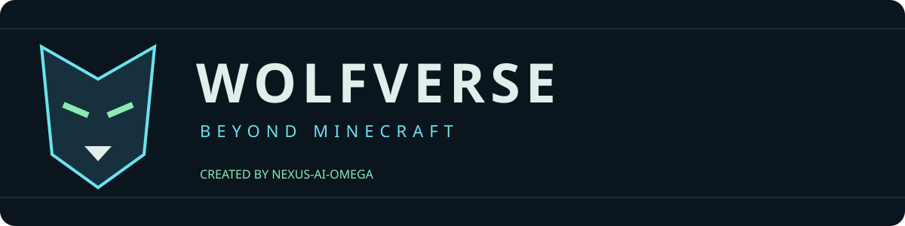

# WOLFVERSE – BEYOND MINECRAFT

**Created by Nexus-AI-Omega**



Ein zusammenhängendes Minecraft-**Bedrock**-RPG: Dark Fantasy, mystische Technologie und zurückhaltende Cyan-/Grün-Akzente. Dieses Repository ist das eigenständige WOLFVERSE-Projekt. Bestehende WOLF-AI-Projekte und die externe Wissenssammlung werden nicht umgebaut oder mitgeliefert.

## Aktueller Stand: Foundation 0.1.0 – Entwicklungsbuild

**Implementiert, aber noch nicht auf dem Nutzergerät abgenommen:**

- Versionierte Spielerprofile mit Schema-/Werte-/Größenprüfung, Migration und Revisionsschutz.
- Echte XP aus erlaubten Survival-Monsterkills, Levelkurve bis 100 und angezeigte Rangstufen. **Noch keine Klassen oder Kampfattribute.**
- Einstiegsquest **„Die erste Wacht“**: drei gewertete Kills; einmalig **75 XP + 30 Coins**.
- Serverseitiger Coins-Shop: **1 Brot für 5 Coins** wird ins echte Inventar geliefert. Volles Inventar führt zur Rückbuchung. Unklarer Kaufstatus sperrt weitere Käufe statt blind erneut auszuliefern.
- Eigener herstellbarer **Codex**, native Menüs für Profil, Quest, Vorräte und Einstellungen; abschaltbares Actionbar-HUD.
- Eigene kleine Icons, drei kurze synthetisierte UI-Sounds und ein begrenzter Level-up-Partikeleffekt. Sound, Partikelqualität und Akzentfarbe lassen sich tatsächlich umschalten.

**Nachweise:** Node-Domänen-/Service- und Runtime-Simulationen, API-2.0-Typprüfung, Python-Pack-/Buildprüfungen sowie zwei echte Starts des offiziellen **BDS 1.26.66.1** inklusive Neustartprobe. Details und genaue aktuelle Ergebnisse: [Testbericht](documentation/testing.md), [lokale Prüfungen](test-results/verification.json), [BDS-Proben](test-results/bds-verification.json).

**Nicht als getestet behauptet:** iPad-Touch/Import, native Menüdarstellung, Client-Grafik/Ton, echte Player-Daten nach Wiederbeitritt, Realm, zwei echte Spieler und Langzeit-FPS. Der BDS-Test verwendet **keine verbundenen Spieler**. Das große RPG ist noch nicht fertig.

## Ausprobieren

1. Zuerst eine **Kopie einer Welt** anlegen, nicht den einzigen Spielstand verwenden.
2. [WOLFVERSE-Foundation-0.1.0.mcaddon](artifacts/WOLFVERSE-Foundation-0.1.0.mcaddon) herunterladen und mit Minecraft Bedrock öffnen.
3. In der Testwelt **WOLFVERSE BP und RP** aktivieren. Die Foundation nutzt stabile Script-API 2.0 und verlangt keine Beta-Experimente.
4. Beim ersten Beitritt wird bei freiem Inventarplatz ein Codex ergänzt. Ersatzrezept an der Werkbank: vier Papier um einen Eisenbarren.
5. Codex benutzen, in Survival drei erlaubte Monster mit mindestens zwei Sekunden Abstand besiegen, Questbelohnung im Journal abholen und Brot kaufen.
6. Welt verlassen/erneut öffnen und die [Geräte-Prüfliste](documentation/device_checklist.md) abarbeiten.

Die tatsächlich installierte Minecraft-Version und der erste Zielhost wurden noch nicht angegeben. `min_engine_version: 1.21.90` ist eine technische Untergrenze, **kein hier ausgeführter Test auf dieser alten Version**. Preview/Beta ist vom Projektauftrag erlaubt, wird vom Core aber nicht unnötig verlangt. [Installation und Grenzen](documentation/installation.md).

## Nächster Ausbau: Fuchs zuerst

**M1** liefert zunächst genau einen zuverlässigen eigenen Fuchsbegleiter: Besitz, Folgen/Warten/Zurückrufen, Entlassen sowie sichere Behandlung von Entladen und Wiederbeitritt. Noch keine Begleiter-Schaltfläche ohne Funktion. Erst danach Varianten, Persönlichkeiten und fünf Entwicklungsstufen.

Klassen, Skilltrees, Magie, VOID KING, Dungeons, zusätzliche Währungen, Clans und optionale KI sind **geplant, nicht implementiert**. [Roadmap](documentation/roadmap.md) · [vollständiger Funktions-Backlog](documentation/systems.md) · [Fuchs-Entwurf](documentation/fox_m1.md).

## Entwicklung

Node.js 20+ und Python 3.10+; keine Modloader, keine Java-Edition-Befehle, keine globalen Node-Pakete nötig.

```sh
npm ci --ignore-scripts --no-audit --no-fund
npm run verify
```

Das erzeugt Prüfberichte in `test-results/` und ein deterministisches `.mcaddon` in `artifacts/`. Pillow/numpy/soundfile sind **nur** zum optionalen Neuerstellen der bereits enthaltenen Originalassets nötig. Keine BDS-Binärdateien oder fremden Assetbibliotheken werden ins Repository übernommen.

- [Architektur](documentation/architecture.md) · [36 Modulverträge und Abhängigkeiten](documentation/modules.csv)
- [Daten/Migration/Kaufwiederherstellung](documentation/data_model.md) · [tatsächliche 0.1-API](documentation/api_reference.md)
- [Konfiguration](documentation/configuration.md) · [Sicherheit](documentation/security.md)
- [Kompatibilität](documentation/compatibility.md) · [Recherchebelege](documentation/research.md)
- [Entwicklerleitfaden](documentation/developer.md) · [Fehlersuche](documentation/troubleshooting.md)
- [24 Ressourcen-Gruppen: erstellt/geplant](documentation/resources.csv) · [Credits/Rechte](documentation/credits.md)
- [Changelog](CHANGELOG.md) · [private Lizenzentscheidung](LICENSE.md)

## Was GitHub speichert – und was nicht

Dieses Projekt soll im ausdrücklich gewünschten **neuen privaten Repository WOLFVERSE** versioniert werden. Der nachweisbare Remote-Stand steht in `documentation/repository.md`; ohne erfolgreichen Push ist eine lokale Datei noch kein GitHub-Backup.

Versioniert werden Quellcode, Originalassets, Dokumentation, Lockfile, kleine Prüfberichte und der Entwicklungsbuild. **Minecraft-Welten/Spielstände sind nicht enthalten** und benötigen eigene Weltbackups. Es läuft kein versteckter dauerhafter Cloud-Autosave und kein KI-Backend. Neue abgeschlossene Arbeitsstände müssen jeweils erneut committed und gepusht werden.

Nicht offiziell mit Mojang oder Microsoft verbunden. Minecraft und zugehörige Marken/Rechte gehören ihren jeweiligen Rechteinhabern.
